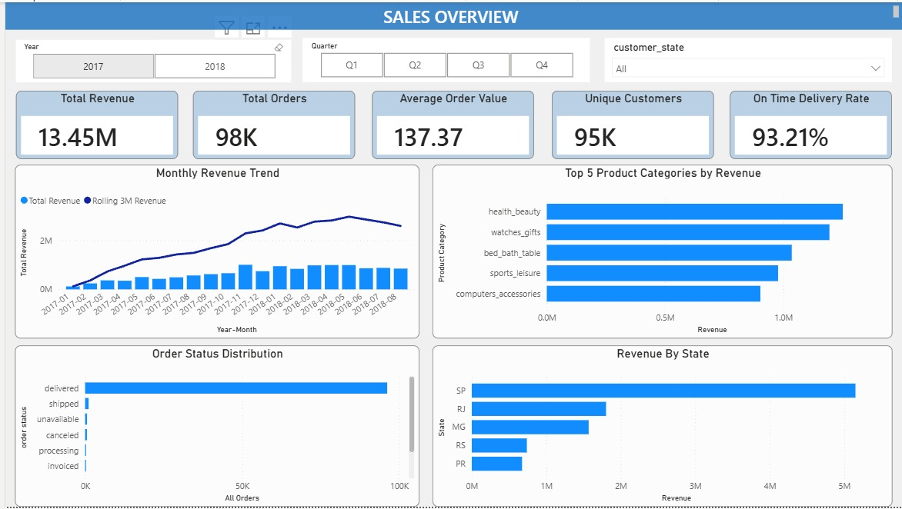
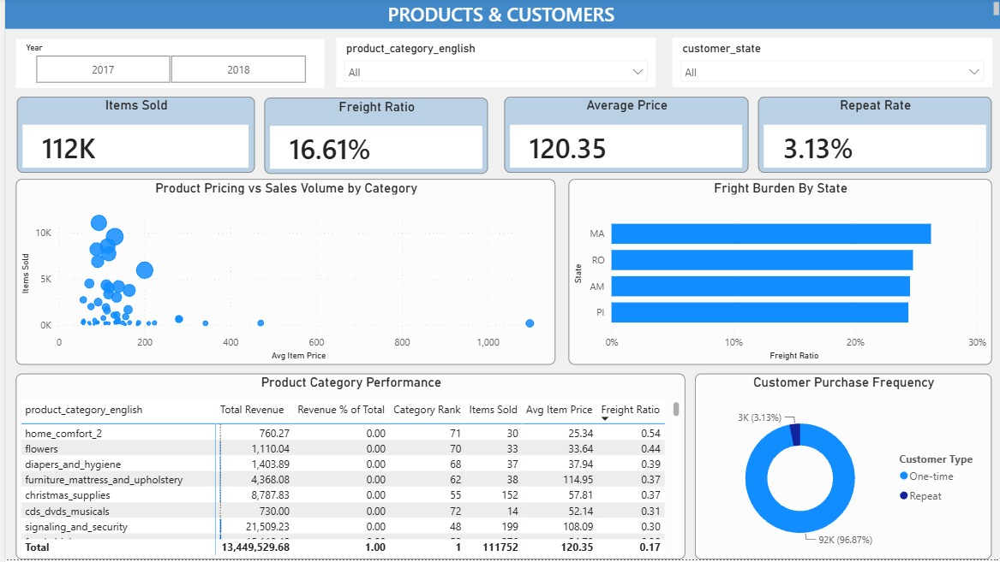
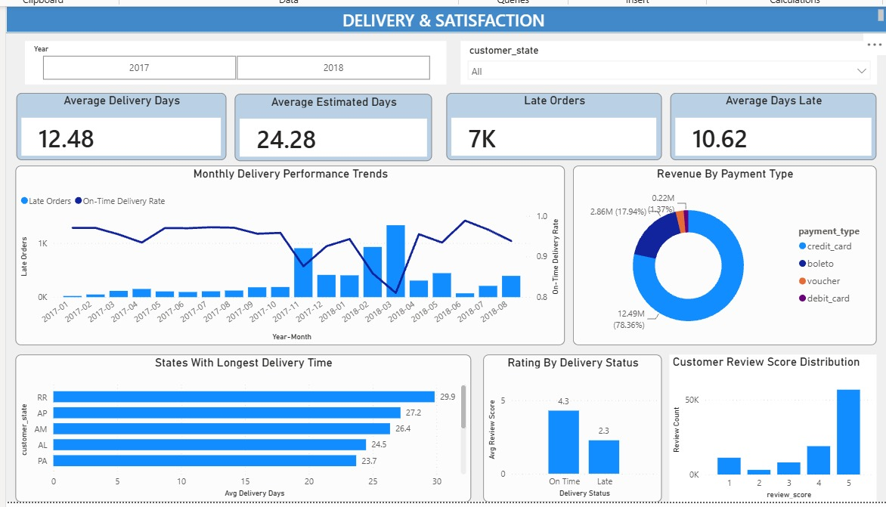

# Brazilian E-Commerce Sales Analysis & Interactive Dashboard

An interactive, three-page Power BI dashboard built to analyse Brazilian e-commerce sales, product performance, customer purchasing behaviour, delivery efficiency, and customer satisfaction using the Olist dataset.

## Project Overview

This project explores the Brazilian e-commerce marketplace using historical order and customer data from Olist. The objective was to transform the data into an interactive business intelligence dashboard that provides insights into sales performance, product categories, customer behaviour, and delivery operations.

The report consists of three interconnected dashboard pages, each focusing on a different aspect of business performance.

## Dashboard Preview

### 1. Sales Overview

### 2. Products & Customers

### 3. Delivery & Satisfaction

## Tools & Technologies

- **Power BI Desktop** – Dashboard development and data visualisation
- **DAX** – Measures, calculated columns, and business metrics
- **Power Query** – Data transformation and preparation

## Dashboard Pages

### 1. Sales Overview

Provides a high-level overview of overall business performance.

**Key metrics:**
- Total Revenue
- Total Orders
- Average Order Value
- Unique Customers
- On-Time Delivery Rate

**Visualisations:**
- Monthly Revenue Trend with 3-Month Rolling Revenue
- Top 5 Product Categories by Revenue
- Order Status Distribution
- Revenue by State

### 2. Products & Customers

Explores product performance, pricing patterns, and customer purchasing behaviour.

**Key metrics:**
- Items Sold
- Freight Ratio
- Average Item Price
- Repeat Customer Rate

**Visualisations:**
- Product Pricing vs Sales Volume by Category
- Freight Burden by State
- Product Category Performance Scorecard
- Customer Purchase Frequency (Repeat vs One-Time Customers)

### 3. Delivery & Satisfaction

Examines delivery performance and its relationship with customer satisfaction.

**Key metrics:**
- Average Delivery Days
- Average Estimated Delivery Days
- Late Orders
- Average Days Late

**Visualisations:**
- Monthly Delivery Performance Trends
- Revenue by Payment Type
- States with Longest Average Delivery Times
- Average Customer Rating by Delivery Status
- Customer Review Score Distribution

## Key Features

- Three-page interactive dashboard with consistent formatting and design.
- Dynamic filtering using Year, Quarter, Product Category, and Customer State slicers.
- DAX measures for calculating business KPIs and performance metrics.
- Time-based analysis using a dedicated date table.
- Comparative analysis of product categories, customer segments, and geographical performance.
- Interactive visualisations for exploring sales, delivery, and customer satisfaction trends.

## My Contribution

This was a collaborative project with responsibilities divided between data preparation and dashboard development.

**My contributions focused on:**
- Developing DAX measures for business metrics such as Total Revenue, Average Order Value, Repeat Customer Rate, Freight Ratio, and On-Time Delivery Rate.
- Creating calculated columns and measures to support business analysis.
- Designing and developing all three Power BI dashboard pages.
- Selecting and configuring appropriate visualisations to communicate business insights.
- Implementing interactive slicers, KPI cards, and time-based analysis.
- Formatting and organising the dashboards for clarity and consistency.

**Data cleaning and preprocessing were carried out by my project collaborator.**

## Dataset

**Brazilian E-Commerce Public Dataset by Olist**

The dataset contains information about Brazilian e-commerce orders, customers, products, payments, reviews, and deliveries.

Source: [Olist Brazilian E-Commerce Dataset – Kaggle](https://www.kaggle.com/datasets/olistbr/brazilian-ecommerce)

## Repository Contents

- `Olist_Dashboard.pbix` – Power BI dashboard file.
- `Screenshots/` – Screenshots of the three dashboard pages.

